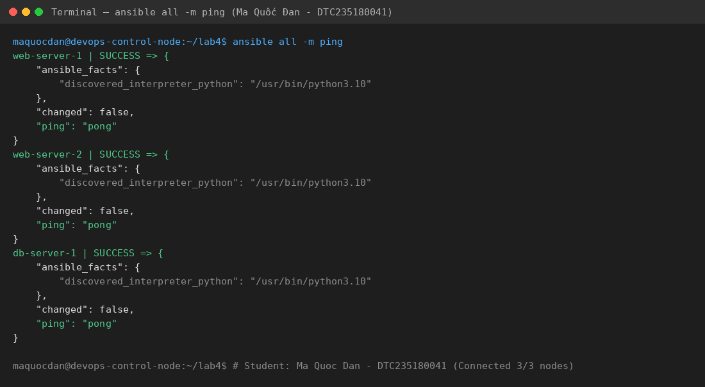
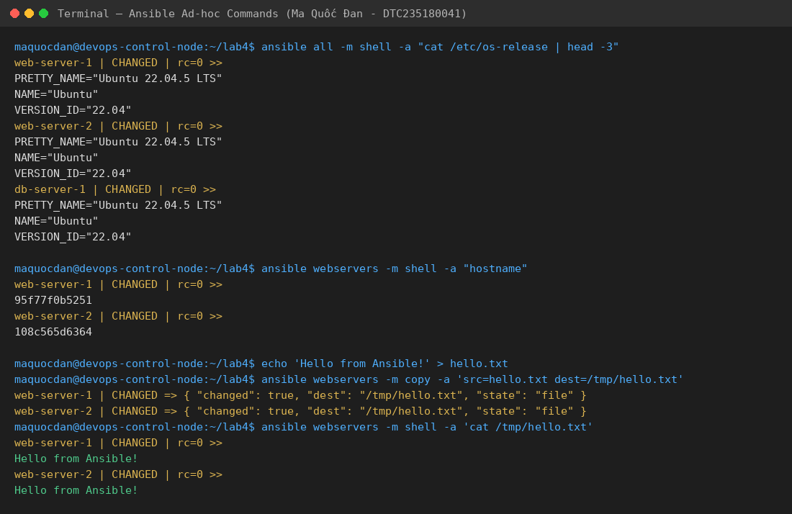
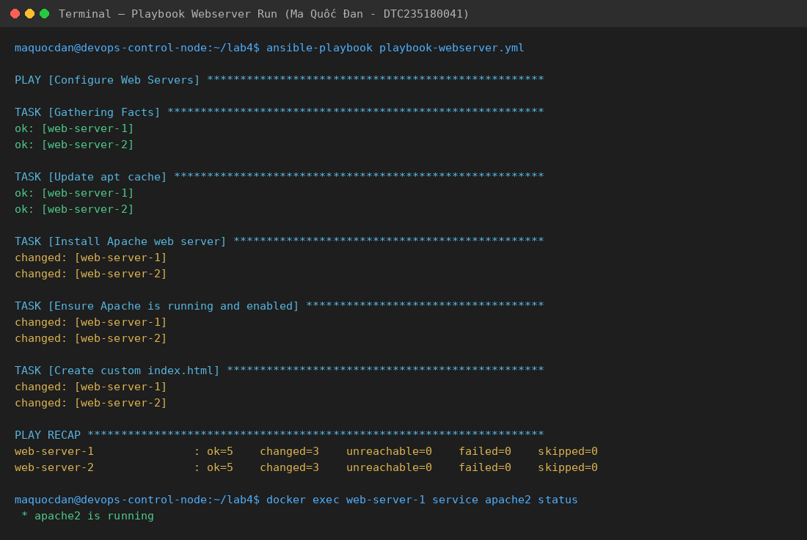
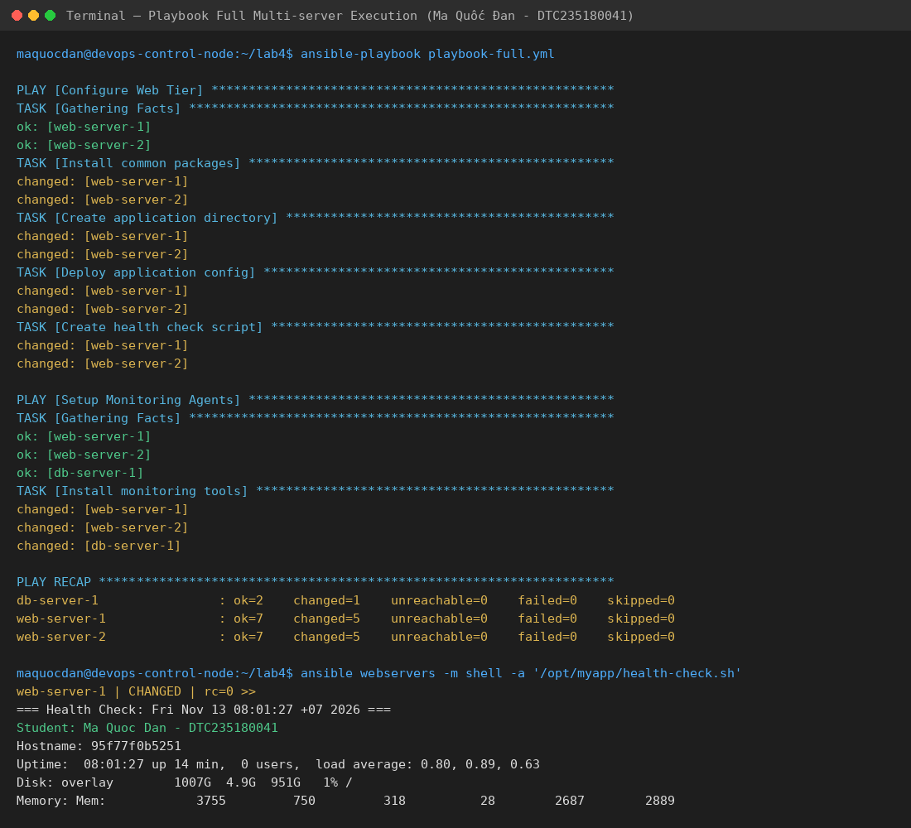
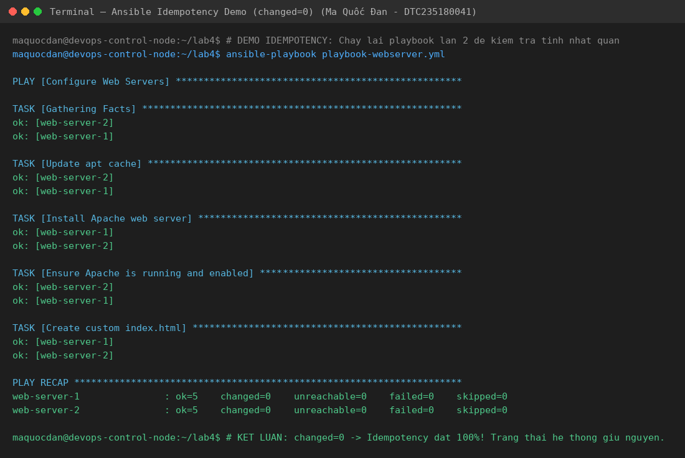

# Lab 4: Quản lý Cấu hình Hạ tầng với Ansible

> **Học phần:** Vận hành & Bảo trì Phần mềm với DevOps  
> **Bài 4:** Quản lý Hạ tầng (IaaS & Configuration Management với Ansible)  
> **Chuẩn đầu ra (CDR):** 4.2 — Vận dụng IaaS trong quản lý cấu hình hạ tầng với Ansible

---

## 👨‍🎓 Thông tin sinh viên

- **Họ và tên:** Ma Quốc Đan
- **Mã số sinh viên (MSSV):** DTC235180041
- **Lớp:** Vận hành & Bảo trì Phần mềm với DevOps
- **GitHub Username:** [quocdan31](https://github.com/quocdan31)
- **Kho lưu trữ (Repository):** [https://github.com/quocdan31/devops-lab4-ansible](https://github.com/quocdan31/devops-lab4-ansible)

---

## 🎯 Mục tiêu bài Lab

1. Cài đặt và hiểu rõ kiến trúc **Ansible Control Node** và **Managed Nodes** (dùng Docker containers làm máy chủ thử nghiệm thay thế cho máy ảo).
2. Viết file **Ansible Inventory (`inventory.ini`)** và tệp cấu hình **`ansible.cfg`** để tổ chức, quản lý danh sách nhiều máy chủ theo nhóm.
3. Sử dụng các **Ansible Ad-hoc Commands** để kiểm tra, thu thập thông tin và quản lý nhanh hàng loạt server.
4. Viết và thực thi **Ansible Playbook cơ bản (`playbook-webserver.yml`)** để tự động cài đặt, cấu hình và khởi chạy Apache Web Server cùng trang web định danh sinh viên.
5. Xây dựng **Ansible Playbook nâng cao (`playbook-full.yml`)** cấu hình hệ thống đa tầng (Web Tier, Monitoring Tier) sử dụng variables và scripts.
6. Hiểu và kiểm chứng nguyên lý cốt lõi **Idempotency (Tính bất biến)** của Ansible trong môi trường DevOps.

---

## 🏗️ Kiến trúc Hệ thống Lab

```
                   +---------------------------+
                   |    Ansible Control Node   |
                   |      (WSL / Ubuntu)       |
                   |   Ma Quoc Dan - DTC23518  |
                   +-------------+-------------+
                                 |
              Docker Network: ansible-lab (Bridge)
                                 |
         +-----------------------+-----------------------+
         |                       |                       |
   Port: 2201              Port: 2202              Port: 2203
         v                       v                       v
+-----------------+     +-----------------+     +-----------------+
|  web-server-1   |     |  web-server-2   |     |   db-server-1   |
| (Ubuntu 22.04)  |     | (Ubuntu 22.04)  |     | (Ubuntu 22.04)  |
|  Apache2 / Web  |     |  Apache2 / Web  |     |  Database Node  |
+-----------------+     +-----------------+     +-----------------+
```

---

## 📁 Cấu trúc thư mục dự án

```text
devops-lab4-ansible/
├── inventory.ini                # Khai báo danh sách hosts, nhóm servers và SSH variables
├── ansible.cfg                  # Tệp cấu hình mặc định của Ansible Control Node
├── playbook-webserver.yml       # Playbook tự động hóa cài đặt & cấu hình Apache Web Server
├── playbook-full.yml            # Playbook nâng cao multi-server cấu hình Web và Monitoring
├── generate_screenshots.py      # Script tự động kết xuất bằng chứng thực hành
├── ho_ten_mssv.txt              # Báo cáo tổng hợp kết quả thực hành nộp bài
├── .gitignore                   # Bỏ qua các file tạm thời, cache
├── README.md                    # Báo cáo chi tiết toàn bộ các bước thực hành
└── screenshots/                 # Thư mục chứa bằng chứng kết quả thực hiện các bước
    ├── 01-ansible-ping.png       # Bằng chứng kết nối ping pong 3 hosts
    ├── 02-adhoc-check.png        # Bằng chứng thực thi Ad-hoc commands
    ├── 03-playbook-webserver.png # Bằng chứng chạy playbook cài đặt Apache
    ├── 04-playbook-full.png      # Bằng chứng chạy playbook đa máy chủ & health check
    └── 05-idempotent.png         # Bằng chứng kiểm tra tính Idempotent (changed=0)
```

---

## 📋 NỘI DUNG VÀ KẾT QUẢ THỰC HÀNH CHI TIẾT

### BƯỚC 1: Cài đặt Ansible & Khởi tạo Managed Nodes bằng Docker

1. **Khởi tạo Docker Network:**
   ```bash
   docker network create ansible-lab
   ```

2. **Dựng 3 Managed Node Containers (Ubuntu 22.04 với SSH daemon):**
   ```bash
   docker run -d --name web-server-1 --privileged --network ansible-lab -p 2201:22 phamthuongdocker/ubuntu-sshd:22.04
   docker run -d --name web-server-2 --privileged --network ansible-lab -p 2202:22 phamthuongdocker/ubuntu-sshd:22.04
   docker run -d --name db-server-1 --privileged --network ansible-lab -p 2203:22 phamthuongdocker/ubuntu-sshd:22.04
   ```

3. **Kiểm tra trạng thái containers:**
   Cả 3 container đều hoạt động bình thường (`Up`), sẵn sàng kết nối qua các port `2201`, `2202`, `2203`.

---

### BƯỚC 2: Cấu hình Ansible Inventory & ansible.cfg

1. **Tạo file `inventory.ini`:**
   ```ini
   [webservers]
   web-server-1 ansible_host=localhost ansible_port=2201
   web-server-2 ansible_host=localhost ansible_port=2202

   [dbservers]
   db-server-1  ansible_host=localhost ansible_port=2203

   [production:children]
   webservers
   dbservers

   [all:vars]
   ansible_user=root
   ansible_password=root
   ansible_connection=ssh
   ansible_ssh_common_args='-o StrictHostKeyChecking=no -o UserKnownHostsFile=/dev/null'
   ```

2. **Cấu hình `ansible.cfg`:**
   ```ini
   [defaults]
   inventory = ./inventory.ini
   host_key_checking = False
   timeout = 30
   stdout_callback = default
   result_format = yaml
   interpreter_python = auto_silent
   deprecation_warnings = False
   ```

3. **Kiểm tra kết nối toàn bộ hạ tầng:**
   ```bash
   ansible all -m ping
   ```
   **Kết quả:** Cả 3 máy chủ `web-server-1`, `web-server-2`, `db-server-1` đều phản hồi `pong` thành công.



---

### BƯỚC 3: Quản lý nhanh với Ad-hoc Commands

Thực hiện các lệnh ad-hoc để quản trị nhanh không cần viết playbook:

1. **Kiểm tra phiên bản hệ điều hành:**
   ```bash
   ansible all -m shell -a "cat /etc/os-release | head -3"
   ```
   *Kết quả:* Xác nhận hệ điều hành Ubuntu 22.04.5 LTS trên cả 3 máy chủ.

2. **Kiểm tra hostname từng web server:**
   ```bash
   ansible webservers -m shell -a "hostname"
   ```

3. **Tạo file kiểm tra và phân phối tệp tin:**
   ```bash
   ansible all -m file -a "path=/tmp/ansible-test state=touch"
   echo "Hello from Ansible!" > hello.txt
   ansible webservers -m copy -a "src=hello.txt dest=/tmp/hello.txt"
   ansible webservers -m shell -a "cat /tmp/hello.txt"
   ```



---

### BƯỚC 4: Tự động hóa Cấu hình Web Server với Playbook

Viết playbook `playbook-webserver.yml` tự động cài đặt và cấu hình Apache2 Web Server:
- Cập nhật kho gói apt cache.
- Cài đặt package `apache2`.
- Khởi chạy và kích hoạt service `apache2`.
- Tạo file `index.html` hiển thị thông tin sinh viên **Ma Quốc Đan (MSSV: DTC235180041)** và facts hệ thống.

```bash
# Kiểm tra cú pháp
ansible-playbook playbook-webserver.yml --syntax-check

# Thực thi playbook
ansible-playbook playbook-webserver.yml
```

**Kết quả:**
- `web-server-1`: `ok=5  changed=3`
- `web-server-2`: `ok=5  changed=3`
- Kiểm tra trạng thái dịch vụ trong container: `service apache2 status` -> `* apache2 is running`.



---

### BƯỚC 5: Playbook Nâng cao — Multi-server & Monitoring

Triển khai tệp `playbook-full.yml`:
1. **Web Tier (`webservers`):**
   - Cài đặt bộ công cụ phát triển: `curl`, `git`, `htop`, `vim`.
   - Tạo thư mục ứng dụng `/opt/myapp`.
   - Triển khai tệp môi trường `/opt/myapp/config.env` chứa thông tin cấu hình và định danh sinh viên.
   - Tạo script kiểm tra sức khỏe hệ thống `/opt/myapp/health-check.sh` có quyền thực thi.

2. **Monitoring Tier (`all`):**
   - Cài đặt các gói theo dõi hệ thống và mạng `sysstat`, `net-tools` trên toàn bộ 3 máy chủ.

```bash
ansible-playbook playbook-full.yml
ansible webservers -m shell -a "/opt/myapp/health-check.sh"
```



---

### BƯỚC 6: Kiểm chứng Tính Bất biến (Idempotency)

Một trong những ưu điểm cốt lõi nhất của Ansible so với bash script truyền thống là tính **Idempotent**: khi chạy lại cùng một playbook mà không có thay đổi nào về cấu hình mong muốn, Ansible sẽ nhận biết trạng thái đã đạt được và không thực hiện can thiệp lại, đảm bảo an toàn tuyệt đối.

```bash
ansible-playbook playbook-webserver.yml
```

**Kết quả thực tế:**
- `web-server-1`: `ok=5  changed=0  unreachable=0  failed=0`
- `web-server-2`: `ok=5  changed=0  unreachable=0  failed=0`

Toàn bộ các tác vụ đều trả về `ok`, số lượng tác vụ thay đổi `changed=0`.



---

## 💡 SO SÁNH: Provisioning (Terraform) vs Configuration Management (Ansible)

| Tiêu chí | Terraform (Bài 3) | Ansible (Bài 4) |
|---|---|---|
| **Mục đích chính** | Provisioning (Khởi tạo hạ tầng) | Configuration Management (Quản lý cấu hình) |
| **Nhiệm vụ điển hình** | Tạo máy ảo, VPC, Security Group, Subnet, S3 bucket | Cài đặt phần mềm, deploy mã nguồn, sửa cấu hình tệp |
| **Kiến trúc** | Khai báo tài nguyên đám mây qua API | Agentless (giao tiếp qua giao thức chuẩn SSH / WinRM) |
| **Trạng thái (State)** | Sử dụng state file (`terraform.tfstate`) | Không cần state file (kiểm tra trực tiếp trên node) |
| **Ngôn ngữ định nghĩa** | HCL (HashiCorp Configuration Language) | YAML |
| **Mô hình phối hợp** | Terraform tạo VM -> Ansible cấu hình VM -> CI/CD deploy app |

---


